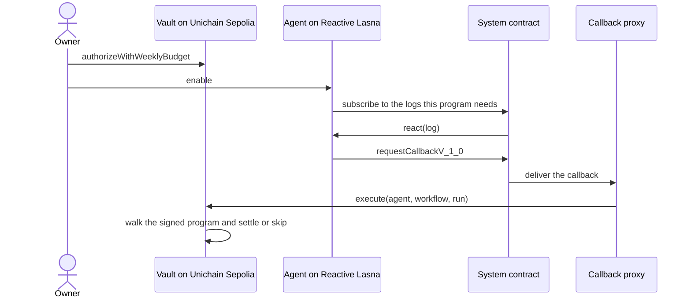

# Rulebook

Rulebook is a Set It and Forget It entry for the [Reactive Omni Buildathon](https://dorahacks.io/hackathon/reactive-omni-buildathon). It lets a person who can connect a wallet leave a personal automation running: buy on a schedule, forward part of an incoming payment, refill a balance, sell when a pool price moves, or pay a chosen wallet after a long silence.

The hosted app is at [rulebook-chi.vercel.app](https://rulebook-chi.vercel.app).

You describe the workflow in the app. Your wallet owns an Agent on Reactive Lasna and a Vault on Unichain Sepolia. The Agent subscribes to the logs that workflow needs, evaluates them in `react`, and asks Reactive to call the Vault. The Vault checks the program you signed and then swaps, transfers, refills, records an alert, or records a skip. Stopping the app leaves a funded workflow running.

Testnet only. You fund the Vault and the two network credits yourself.

## What to open first

The judging bar for this track is a reactive transaction, the callback it causes, a tool worth leaving on, and a repository someone else can follow. Start with the receipts, then the two contracts that produced them.

| Open this                                                                  | What it shows                                                                   |
| -------------------------------------------------------------------------- | ------------------------------------------------------------------------------- |
| [Income payment of 1.20 USDC](#a-payment-that-takes-three-different-paths) | One `Transfer` becomes a Lasna decision and a Unichain payout.                  |
| [Scheduled buy](#a-schedule-that-fires-on-the-next-lasna-block)            | `Cron100` on Lasna, `react` on the next block, swap through the callback proxy. |
| [`WorkflowAgentV2.sol`](contracts/src/workflow/v2/WorkflowAgentV2.sol)     | Subscriptions, price and activity memory, `Dispatched`, `requestCallbackV_1_0`. |
| [`WorkflowVaultV2.sol`](contracts/src/workflow/v2/WorkflowVaultV2.sol)     | The signed program, per-run caps, weekly budget, and the settlement.            |

## A payment that takes three different paths

The workflow is an income sweep. It watches USDC transfers into one Vault. The signed program has two payment thresholds:

- A payment of at least 1.00 USDC sends 0.20 USDC to the chosen recipient.
- A smaller payment of at least 0.25 USDC sends 0.05 USDC.
- Anything below both thresholds is skipped. The workflow stays on.

Three USDC transfers into the same Vault each completed the loop: Unichain `Transfer`, Lasna `react`, Unichain callback.

| Payment in | Path | Vault did             | Origin `Transfer`                                                                                                | Lasna `react`                                                                                                    | Callback                                                                                                         |
| ---------- | ---- | --------------------- | ---------------------------------------------------------------------------------------------------------------- | ---------------------------------------------------------------------------------------------------------------- | ---------------------------------------------------------------------------------------------------------------- |
| 1.20 USDC  | 1    | Sent 0.20 USDC        | [0x714e…83f8](https://sepolia.uniscan.xyz/tx/0x714e0c157898d3a79b9e4ae3ab69f1dab6fa340eb0255d12053aac690fd983f8) | [0x03dc…2638](https://lasna.reactscan.net/tx/0x03dca7bb85b59ca005c20601f41f3e472e2a0bf3a58ab6a29d51d532fe192638) | [0xba91…099e](https://sepolia.uniscan.xyz/tx/0xba91dc7ea2e98b4acc03c3b322e810b08e5edc45685bfc21dc992a26dc25099e) |
| 0.60 USDC  | 3    | Sent 0.05 USDC        | [0x17ec…b9a8](https://sepolia.uniscan.xyz/tx/0x17ec5ee9fe16604548b664e3634aa26469bdf8354bad45902e511e4e56bbb9a8) | [0x49a0…89c8](https://lasna.reactscan.net/tx/0x49a056ef6e9168ca65ccdfb923c1d8769d494efe43e8f3942036a84ce18e89c8) | [0x6a4d…dc07](https://sepolia.uniscan.xyz/tx/0x6a4d944f3d0d9bd4e8561a01506e00db5a6e9baaac39c358399f92718dafdc07) |
| 0.10 USDC  | 4    | Skipped, sent nothing | [0x2396…bd60](https://sepolia.uniscan.xyz/tx/0x239630065d398b717bf19ac1d3c75c5b793f26bd8e9e54895fb1361e37a0bd60) | [0x2441…e422](https://lasna.reactscan.net/tx/0x2441cefd445348f64914787f76da66582e37bba2d643b0790e8de3f093c1e422) | [0xa7a5…6214](https://sepolia.uniscan.xyz/tx/0xa7a51f37fec05a39782a26feb3f60bb20e50d1840cf73a1ad3f1cb3032b66214) |

The 1.20 USDC payment was mined on Unichain at 06:28:49 UTC. The callback was mined at 06:28:52 UTC. The skip has a callback too: the destination receipt contains the Vault and no USDC transfer. The same event still woke the Agent, and the Vault still applied the signed program.

That sweep belongs to this wallet:

| Contract | Address                                                                                                                        |
| -------- | ------------------------------------------------------------------------------------------------------------------------------ |
| Agent    | [`0x6bF114548E7A748c7E8ED736b0E80c07B01291F8`](https://lasna.reactscan.net/address/0x6bF114548E7A748c7E8ED736b0E80c07B01291F8) |
| Vault    | [`0x95855cd060ef40B1212Eb1366365f3C925F300be`](https://sepolia.uniscan.xyz/address/0x95855cd060ef40B1212Eb1366365f3C925F300be) |

On the Lasna receipt, the transaction is sent to the system contract. The Agent emits `Dispatched` from inside that call. On Unichain, the settlement transaction is sent to the callback proxy, and the Vault emits `Outcome`.

## A schedule that fires on the next Lasna block

The same wallet ran a scheduled buy. It watches `Cron100` at `0x0000000000000000000000000000000000fffFfF`. Its tick and its `react` are consecutive Lasna blocks, one second apart on Lasna's clock. The swap landed on Unichain two seconds after `react`. The destination receipt moves USDC and WETH through the configured pair.

| Workflow      | Origin                                                                                                                             | Lasna `react`                                                                                                                 | Callback                                                                                                                         |
| ------------- | ---------------------------------------------------------------------------------------------------------------------------------- | ----------------------------------------------------------------------------------------------------------------------------- | -------------------------------------------------------------------------------------------------------------------------------- |
| Scheduled buy | [Lasna `Cron100`, 06:30:33 UTC](https://lasna.reactscan.net/tx/0xa0dbed575f09181e3c3c62b83fc3a3cbdd6b76e68ff2aa330a39ccc61cfa10df) | [Next block, 06:30:34 UTC](https://lasna.reactscan.net/tx/0xc66cac219fbffefcac68212e1a984edc775d8e7c7936c497bd001900149d549c) | [Unichain swap, 06:30:36 UTC](https://sepolia.uniscan.xyz/tx/0xd377b1311e7aa8871e1c25bd3e46480e0da35944f25164d53d5674dd06a7005d) |

Both runs are recorded in [`deployments/workflows-v2-smoke.json`](deployments/workflows-v2-smoke.json), which also names the factories and commit that produced them.

## What you can leave running

Open **Workflows → New workflow**, pick a recipe, and fill in the amounts. The same screen can start from a blank canvas. A check splits the workflow into a Yes path and an Otherwise path. Each path holds up to three checks and three ordered actions. The review names the network, the amounts, the recipient, the caps, and the expiry before the wallet signs.

| You want                              | Recipe               | What wakes it                                                   | What the Vault can do                          |
| ------------------------------------- | -------------------- | --------------------------------------------------------------- | ---------------------------------------------- |
| Buy a fixed amount on a timer         | Scheduled buy        | `Cron100`                                                       | Swap USDC for WETH                             |
| Buy only after a drop                 | Buy more on a dip    | `Cron100`, using the latest `Sync`                              | Swap, or skip                                  |
| Buy if the price reaches a limit      | Limit buy            | Pair `Sync`                                                     | One swap, then the workflow closes             |
| Sell into strength                    | Take profit          | Pair `Sync`                                                     | One swap, then the workflow closes             |
| Sell if the price falls from its high | Trailing stop        | Pair `Sync`                                                     | One swap off a fixed stop or a trail           |
| Trade around a reference price        | Price-band trading   | Pair `Sync`                                                     | Buy below the band, sell above it              |
| Pay someone on a timer                | Recurring transfer   | `Cron100`                                                       | Send USDC                                      |
| Forward part of income                | Income sweep         | USDC `Transfer` into the Vault                                  | Send a larger or smaller amount, or skip       |
| Top up the Vault from your wallet     | Balance refill       | `Cron100`                                                       | `transferFrom` up to the allowance and the cap |
| Name a recipient if you go quiet      | Inactivity payout    | `Cron100`, plus your own USDC transfers                         | One payout after a 24-hour grace period        |
| Hear about a price                    | Price alert          | Pair `Sync`                                                     | Record an alert, move no funds                 |
| Hear when a price leaves a range      | Price-range alert    | Pair `Sync`                                                     | Record an alert                                |
| Hear about a large movement           | Large-transfer alert | `Transfer` of a token you name, from or to the wallet you watch | Record an alert                                |

Price checks use the last `Sync` on the configured USDC/WETH pair, quoted as USDC per WETH. The Agent keeps that price, the previous price, and, for a trailing stop, the high since the workflow was enabled. A dip compares the two prices.

An inactivity payout needs an explicit confirmation in the review, a fixed recipient and amount, and at least one day of silence. Silence means no USDC `Transfer` from the owner. When the grace period starts, the owner can check in. A check-in clears the pending payout. The payout can happen only once.

A weekly spending budget is optional and per asset. It sits on top of the per-run caps. A run that would cross either weekly limit is skipped whole, the workflow stays active, and the reason is **Run would exceed the weekly spending budget**. The counter resets Monday at 00:00 UTC from the Unichain block timestamp. Editing the budget leaves the schedule and the inactivity window where they are.

The Marketplace lists a workflow you choose to publish. The factory reads the program hash from your Agent, so the listing matches the program you enabled. Someone else can copy it. The copy keeps the listed trigger, checks, amounts, per-run caps, watched wallet, and expiry, and clears the recipients so the copier chooses where their own funds go. They sign it onto their own Agent and fund their own Vault. Publishing, or unpublishing, leaves your workflow running.

Activity shows each run and the path that was taken. **Public proof** is a link to the origin, the Lasna decision, and the settlement. It opens without a wallet. Telegram can send funding warnings, failure and inactivity warnings, and per-workflow run messages. Those messages are notices. The callback remains the settlement.

An optional drafter can turn a sentence into a workflow draft. You still review the program and sign both transactions. The Agent stores those signed bytes, and settlement reads them from the Agent.

## How a run happens



1. The owner signs `authorizeWithWeeklyBudget` on the Vault. That stores the program, its hash, the epoch, the title, and the weekly limits.
2. After that authorization is mined, the owner signs `enable` on the Agent. The Agent checks the same bytes, stores them, and subscribes through the system contract at `0x8888888888888888888888888888888888888888`.
3. A schedule subscribes to `Cron100` on Lasna. A dip or a price workflow also subscribes to `Sync` on the pair. A payment workflow subscribes to USDC transfers into that Vault. A watched-wallet workflow subscribes to transfers of the named token. An inactivity workflow also watches USDC leaving the owner. A one-shot workflow subscribes to the Vault's own `Closed` event and removes its subscriptions after it finishes.
4. `react` accepts only the system contract. It ignores logs the program did not subscribe to. For a schedule it waits until `nextDue`, then carries the cached price or the last activity time. For a price log it updates the cached price and the trailing high. For a transfer it carries the amount and the counterparty. It builds a `Run` that names the origin chain, transaction, log index, and block.
5. The Agent emits `Dispatched` and calls `requestCallbackV_1_0`. The callback targets chain 1301, this owner's Vault, and an 850,000 gas limit. The payload expires ten minutes after the Lasna block. The same origin log cannot dispatch twice.
6. The callback proxy injects the Agent address as the first argument. `execute` requires that caller to be the proxy and that injected address to be the Vault's immutable Agent. A mismatched program hash, epoch, or stale origin is recorded as a skip. An expired payload is recorded as expired.
7. The Vault walks the tree. Caps, slippage, the weekly budget, a one-hour price age, and the inactivity grace period are enforced in that call. A failing step rolls the whole run back, and the Vault still records the outcome. Statuses are confirmed, skipped, expired, failed, and in grace period.

The owner pauses a workflow by revoking the Vault authorization, then disabling it on Lasna. The owner can withdraw Vault principal and recover ETH that was sent to the Vault by mistake. ETH held by the Vault does not pay for callbacks. Callback gas is paid from execution credit deposited to the proxy for that Vault. Lasna gas is paid from watching credit deposited to the system contract for that Agent.

## Limits of one account

These bounds are in the contracts, and the builder enforces the same ones before it asks for a signature.

| Bound                               | Value                              |
| ----------------------------------- | ---------------------------------- |
| Active workflows per Agent          | 4                                  |
| Nodes in one program                | 15                                 |
| Checks on one path                  | 3                                  |
| Actions on one path                 | 3                                  |
| Schedule interval                   | 120 seconds to 30 days             |
| Slippage                            | At most 10%                        |
| Callback gas                        | 850,000                            |
| Callback lifetime                   | 10 minutes                         |
| Price observation age               | 1 hour                             |
| Inactivity minimum                  | 1 day, then a 24-hour grace period |
| Title                               | 1 to 80 characters                 |
| Settlement chain in this deployment | Unichain Sepolia, chain id 1301    |

Intervals, expiries, and the weekly reset use timestamps. A per-run cap is the most the path can spend. The weekly budget, when set, can only make that smaller.

## Contracts and networks

| Role                 | Network                               | Contract                                            | Address                                                                                                                        |
| -------------------- | ------------------------------------- | --------------------------------------------------- | ------------------------------------------------------------------------------------------------------------------------------ |
| Current factory pair | Lasna 5318007 + Unichain Sepolia 1301 | `WorkflowAgentFactoryV2` / `WorkflowVaultFactoryV2` | See [`deployments/workflows-v2.json`](deployments/workflows-v2.json) for addresses, blocks, transactions, and bytecode hashes  |
| System contract      | Reactive Lasna                        | Reactive Omni                                       | [`0x8888888888888888888888888888888888888888`](https://lasna.reactscan.net/address/0x8888888888888888888888888888888888888888) |
| Callback proxy       | Unichain Sepolia                      | Reactive Omni                                       | [`0x775c9B990ADe401060B78D0e98684eEf8d2466C1`](https://sepolia.uniscan.xyz/address/0x775c9B990ADe401060B78D0e98684eEf8d2466C1) |
| Cron                 | Reactive Lasna                        | `Cron100`                                           | [`0x0000000000000000000000000000000000fffFfF`](https://lasna.reactscan.net/address/0x0000000000000000000000000000000000fffFfF) |
| USDC                 | Unichain Sepolia                      |                                                     | [`0x31d0220469e10c4E71834a79b1f276d740d3768F`](https://sepolia.uniscan.xyz/address/0x31d0220469e10c4E71834a79b1f276d740d3768F) |
| WETH                 | Unichain Sepolia                      |                                                     | [`0x4200000000000000000000000000000000000006`](https://sepolia.uniscan.xyz/address/0x4200000000000000000000000000000000000006) |
| Pair                 | Unichain Sepolia                      |                                                     | [`0x1d8698365321D6DcE1F7141c380C866b012eE9dA`](https://sepolia.uniscan.xyz/address/0x1d8698365321D6DcE1F7141c380C866b012eE9dA) |
| Router               | Unichain Sepolia                      |                                                     | [`0x6e8C9D62A16419357eA998229126D2fD6B1CCfbF`](https://sepolia.uniscan.xyz/address/0x6e8C9D62A16419357eA998229126D2fD6B1CCfbF) |

Each wallet calls `create()` on the Lasna factory and receives a clone of `WorkflowAgentV2`. It then calls `create(agent)` on the Unichain factory and receives its own `WorkflowVaultV2`. A second call returns the contract that wallet already owns. The owner links the Vault from the Agent. Setup can resume after either deployment.

The current factory pair, its deployment transactions, indexer start blocks, and bytecode hashes live only in [`deployments/workflows-v2.json`](deployments/workflows-v2.json). The backend, the frontend, and the release job read that record, so this README never repeats deployment addresses. The receipts at the top of this file were produced by the current record; regenerate them with [`scripts/smoke-workflows-v2.ts`](scripts/smoke-workflows-v2.ts) against the current record.

Lasna RPC: `https://lasna-rpc.rnk.dev/`. Unichain Sepolia RPC: `https://sepolia.unichain.org`. Explorers: [lasna.reactscan.net](https://lasna.reactscan.net) and [sepolia.uniscan.xyz](https://sepolia.uniscan.xyz).

## Using the app

Open [rulebook-chi.vercel.app](https://rulebook-chi.vercel.app), or run the frontend locally (see [Run the tests](#run-the-tests)). Connect a wallet that can sign on both networks. Add Reactive Lasna if the wallet asks: chain id `5318007`, the RPC above, and symbol `REACT`.

1. Open **Account & Vault**. Create the Agent on Lasna, create the Vault on Unichain Sepolia, and link them. Each step is a transaction from your wallet. If one of them is already deployed, setup continues from the missing step.
2. Fund three balances, shown separately. Vault USDC pays for buys, transfers, and refunds. Vault WETH is used by workflows that sell WETH. Execution credit is testnet ETH deposited to the callback proxy for your Vault. Watching credit is testnet REACT deposited to the Lasna system contract for your Agent.
3. Build a workflow. A balance refill also asks you to approve the Vault to pull USDC from your wallet, up to the per-run cap.
4. Sign the Unichain authorization, then sign `enable` on Lasna. The review shows the caps before either signature.
5. Open **Activity** for the path and the receipts. Open **Public proof** for a link you can share. **Workflow costs** shows the credits and a live gas quote.

The app reads chain state through its API. The API has no key that can move Vault principal.

## Ask the Bookkeeper

Leaving a workflow on is only half the promise. The other half is being able to tell, months later and without reading a contract or an explorer, whether it is still funded and what it actually did. Bookkeeper is the assistant inside the app that answers that in plain language: what is funded, which workflows are on, why a run was skipped, what a listing promises, and where a notification is going.

The wallet proves who it is before the first answer. The backend issues a short challenge, the wallet signs a message with no gas and no transaction, and the backend verifies the signature against the wallet and the frontend origin. The session token stays in memory and never expires on the server, so a reload asks for a signature again. The owner comes from that session; the request cannot name another wallet.

It is read-only by construction. The model starts with no account data: only the wallet address, the current page, the last twelve messages, and the question. When the question needs a fact, it calls one of seven read-only tools scoped to the session owner.

| Tool                   | Reads                                                                                      |
| ---------------------- | ------------------------------------------------------------------------------------------ |
| `get_account_overview` | Agent and Vault addresses, token balances, watching and execution credit, refill allowance |
| `list_workflows`       | Saved workflows with status, trigger, readable paths, caps, budget, and expiry             |
| `get_workflow`         | One workflow by id                                                                         |
| `list_runs`            | Indexed runs, optionally filtered by workflow or status                                    |
| `get_run`              | One run and its origin, Lasna, and settlement transactions                                 |
| `search_marketplace`   | Public listing titles and descriptions                                                     |
| `get_notifications`    | Telegram connection and per-workflow preferences                                           |

A tool result is capped before it reaches the provider, and the system prompt forbids stating a balance, status, or run fact that no tool returned. A missing contract is reported as unavailable, never as zero. At most eight tools run across four rounds; the last round is sent without tools so the model always explains what it found. References such as a workflow, a run, or a public proof are attached by the backend from the tools that actually ran, not from the model's text.

It cannot sign, move funds, or change a workflow. Limits are 80 questions per wallet per day and 3,000 globally, with 12 requests per minute, and conversations are deleted 30 days after their last activity. The provider receives the question, the recent turns, and only the tool results that question needed. Setup and privacy notes are in [`docs/assistant.md`](docs/assistant.md).

## Repository

| Path                                       | What it is                                                                        |
| ------------------------------------------ | --------------------------------------------------------------------------------- |
| `contracts/src/workflow/v2/`               | Agent, Vault, factories, program validator, and the settlement calls.             |
| `contracts/src/chain/ChainConfig.sol`      | The only chain-address literals in the Solidity sources.                          |
| `contracts/test/`                          | Foundry unit and integration tests, including the recipe matrix.                  |
| `packages/shared/src/workflowV2Recipes.ts` | The 13 recipes. The builder encodes them into the program the contracts validate. |
| `packages/shared/src/chains.ts`            | Chain ids, RPC URLs, and token addresses for the app.                             |
| `frontend/src/workflows/`                  | The canvas, review, account, activity, proof, and marketplace screens.            |
| `backend/src/workflows/`                   | The indexer and the read API.                                                     |
| `deployments/`                             | Factory addresses, creation transactions, and the live-loop record.               |
| `backend/src/assistant/`                   | The Bookkeeper session, tools, provider loop, and streaming route.                |
| `docs/workflows.md`                        | Operator notes for funding, pause, and the weekly budget.                         |
| `docs/assistant.md`                        | Bookkeeper access, tools, limits, and privacy.                                    |
| `docs/submission-evidence.md`              | The cross-chain receipts for the workflow runs.                                   |

## Run the tests

Node.js 24 or newer, npm, and Foundry v1.9.0 with Solidity 0.8.29. Use the Foundry version CI pins: gas snapshot values and coverage differ between Forge releases.

```powershell
npm install
npm test -w packages/shared
npm test -w contracts
```

`npm test -w contracts` runs `forge test`. The integration tests deploy the real Agent and Vault against a mock system contract and a mock callback delivery, then assert the path, the balances, and a replay that must not settle again.

```powershell
npm run verify
```

`npm run verify` is the repository gate and mirrors everything CI runs: formatting, design checks, lint, the secret scan, the Foundry format/build/test suite with its gas snapshot and coverage, the frontend and backend build, typecheck, unit tests, the generated-ABI drift check, and the Playwright browser flows against a local chain. Install the browser once with `npx playwright install chromium`; `npm run test:e2e` runs only the browser suite. Both git and agent hooks call `node scripts/verify-changes.mjs`, which runs this same gate once per change set before a push or before an agent finishes. Running the app against the public testnets also needs `SUPABASE_URL`, `SUPABASE_SERVICE_ROLE_KEY`, and the same `WORKFLOW_V2_DEPLOYMENT` JSON on the backend and `VITE_WORKFLOW_V2_DEPLOYMENT` on the frontend. The shape is `{ lasna: { factory, startBlock }, unichain: { factory, startBlock } }`. Set `VITE_WORKFLOW_V2_ACTIVATION=true` to allow new activations. Deployment steps are in [`docs/workflows.md`](docs/workflows.md).

## License

[MIT](LICENSE). Reactive Network's system contract and callback proxy are theirs. This repository is the factories, the Agent, the Vault, and the app.
